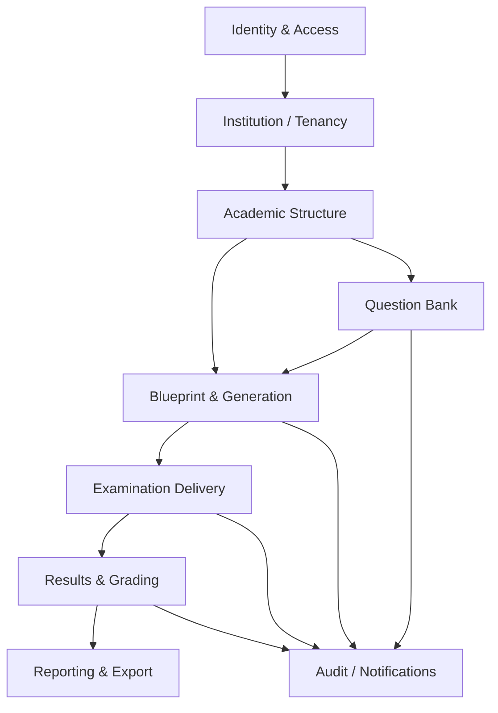

# Module Dependency Map

The diagram represents the intended dependency direction. The modules are not yet implemented as physically separate packages.

## Dependency rules

- Identity provides current actor identity and permissions; it must not depend on domain features.
- Institution/tenancy defines scope used by academic and business records.
- Academic structure supplies classification and context; it does not own question approval logic.
- Question Bank owns question content, versions, classification links, and review state.
- Blueprint/generation selects eligible question versions; it does not edit their content.
- Examination owns exam lifecycle and snapshots; it does not serve private answer keys through generic candidate resources.
- Results depends on a specific exam version/candidate context and preserves all corrections.
- Reports consume authorized read models; reports do not bypass policies/scope filters.
- Audit/notifications are cross-cutting and should not introduce circular business dependencies.

## Current status

Only the identity foundation and partial institution pieces have substantive source files. Academic, question-bank, blueprint, exam, result, and reporting modules are planned. Keep this map as target architecture until implementation exists and tests confirm the boundary.
