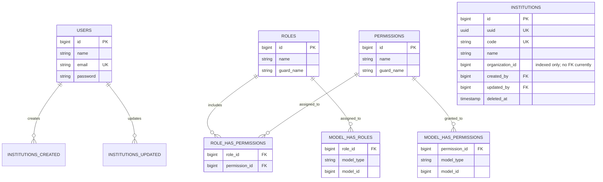
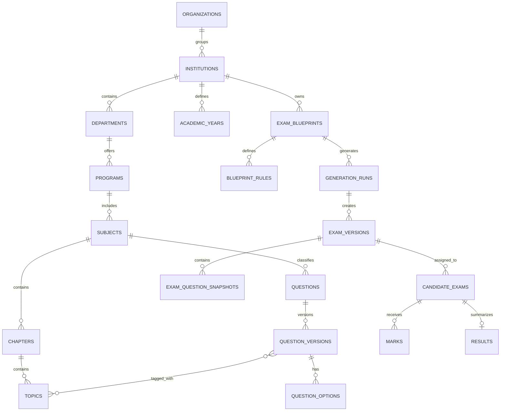

# Entity Relationship Diagrams

This file separates the current schema from the proposed target design. Diagrams are logical and do not substitute for migration inspection.

## Current implemented relationships (migration-backed)

Laravel cache, queue, password reset, and session tables are omitted from the picture for readability; see `DATABASE_DICTIONARY.md`.

## Proposed domain relationship overview

**All entities in the second diagram are proposed logical concepts, not a statement that these tables exist.** The final ERD must be updated as domain decisions and migrations are reviewed.
