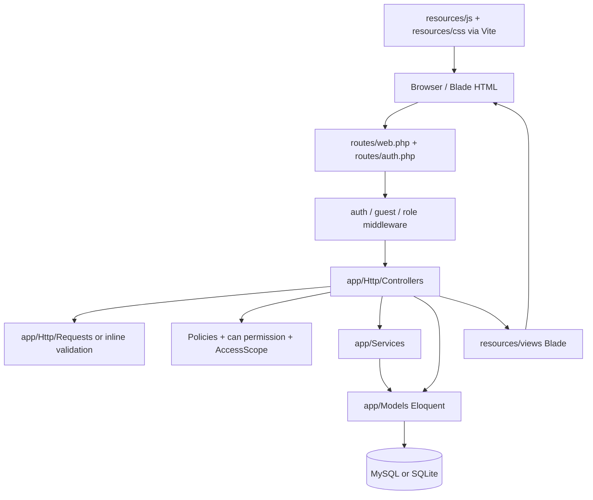

# EQBEMS — Complete Developer Handbook

**System:** EQBEMS (Question Bank & Examination Management System)  
**Documentation based on:** `EQBEMS_Fixed_Reviewed_Source.zip`, reviewed on 20 October 2026  
**Main stack:** Laravel 12 / PHP `^8.2`, Blade, Eloquent, Spatie Laravel Permission, Vite, Bootstrap, Tailwind/Breeze legacy styles, MySQL or SQLite, Pest/PHPUnit.

> **Accuracy boundary:** This handbook describes classes, routes and migrations present in the reviewed source ZIP. It is **not** a claim that all modules were browser-tested or ready for production. Composer dependencies (`vendor/`) and Node dependencies (`node_modules/`) are not shipped. A complete Laravel feature suite, database integration run and Vite build must still be executed in a configured environment. The source includes **17 zero-byte placeholders** (listed below).

## Reading order for new developers

1. Read **this handbook** to understand the product, structure and entry points.
2. Read [04_WORKFLOW_AND_DATA_MAP.md](04_WORKFLOW_AND_DATA_MAP.md) for end-to-end business workflows and sequence diagrams.
3. Read [05_ROUTES_AND_PERMISSIONS.md](05_ROUTES_AND_PERMISSIONS.md) before modifying endpoints or permissions.
4. Follow [06_SETUP_TEST_AND_TROUBLESHOOT.md](06_SETUP_TEST_AND_TROUBLESHOOT.md) to install, run and test locally.
5. Use [07_NEW_DEVELOPER_TASKS.md](07_NEW_DEVELOPER_TASKS.md) for safe change examples and onboarding exercises.
6. Use [08_SCHEMA_REFERENCE.md](08_SCHEMA_REFERENCE.md) for the database, and [03_SOURCE_FILE_INDEX.md](03_SOURCE_FILE_INDEX.md) / [02_COMPLETE_FILE_TREE.txt](02_COMPLETE_FILE_TREE.txt) to locate **every original file**.

## 1. Product in one minute

EQBEMS manages academic institutions, staff and student accounts, subjects/topics, a versioned question bank, independent question approval, exam blueprint creation, printable papers, online exams, grading, and result publication. Its administrative users prepare and review questions; exam controllers configure papers; students attempt published online exams; authorized staff mark written answers and publish results.

The project uses a **Laravel modular monolith**: all modules run in one Laravel application and database, with separate controllers, models, services, views and tests. It is not a microservices project and does not expose a separate documented JSON REST API in the reviewed routes.

### Main actors (seeded role names)

`Super Admin`, `Organization Admin`, `Institution Admin`, `Teacher`, `Question Setter`, `Moderator`, `Exam Controller`, `Student`.

Role-permission assignments are defined in `database/seeders/RolePermissionSeeder.php`. Always check `can('permission.name')` **and** institution scope, not the display label alone. Currently only `Super Admin` is global; other users are tied to an `institution_id` (see `app/Support/AccessScope.php`).

## 2. High-level architecture



Typical request example — `POST /blueprints/{blueprint}/generate`:

1. `routes/web.php` dispatches it to `ExamController@generate` (after login).
2. The controller checks `exam.generate` and institution membership (`AccessScope::allows`).
3. `ExamGenerationService::generate` opens a database transaction and locks the blueprint.
4. `BlueprintPoolService` identifies currently eligible **approved** versions, matching subject/format/type/difficulty.
5. Explicitly selected question IDs are preserved, then random eligible questions fill remaining slots.
6. `Exam`, `ExamQuestion` records are created, copying immutable candidate content and a separately restricted answer snapshot.
7. The controller redirects to the exam review view. Issuing the paper is a **separate** action.

## 3. Practical project folder map

```text
EQBEMS/
├── .github/workflows/quality.yml         # CI: PHP dependencies, migrations, tests, npm build
├── app/
│   ├── Actions/Institution/               # CURRENTLY EMPTY action-class placeholders
│   ├── DTO/                               # CURRENTLY EMPTY DTO placeholders
│   ├── Helpers/helpers.php                 # Composer-loaded helper file
│   ├── Http/
│   │   ├── Controllers/
│   │   │   ├── Auth/                       # Authentication and password controllers
│   │   │   ├── InstitutionController.php   # Institution CRUD + archive/restore
│   │   │   ├── UserController.php          # Admin user/role management
│   │   │   ├── SubjectController.php       # Subjects
│   │   │   ├── TopicController.php         # Topics
│   │   │   ├── AcademicYearController.php  # Academic years
│   │   │   ├── QuestionController.php      # Draft/edit/submit/revise/review
│   │   │   ├── QuestionReviewController.php# Review queue
│   │   │   ├── BlueprintController.php     # Blueprint CRUD, eligible question count
│   │   │   ├── BlueprintQuestionController.php # Pinned question selections
│   │   │   ├── ExamController.php          # Generate/issue/print/settings/answers
│   │   │   ├── OnlineExamController.php    # Take/save/submit/grade online exams
│   │   │   ├── ResultController.php        # Draft/publish/revise results
│   │   │   ├── DashboardController.php     # Dashboard counters
│   │   │   └── ProfileController.php       # Profile + controlled account deletion
│   │   └── Requests/                       # Auth + institution form validation
│   ├── Models/                             # Database tables and relationships
│   ├── Policies/                           # InstitutionPolicy active; QuestionPolicy empty
│   ├── Services/                           # BlueprintPool, ExamGeneration, Grade, etc.
│   ├── Support/AccessScope.php             # Institution access boundary
│   ├── Providers/AppServiceProvider.php    # Laravel service provider
│   └── View/Components/                   # Blade layout components
├── bootstrap/app.php                      # Laravel 12 bootstrap + role aliases
├── config/                                 # Laravel / Spatie / feature settings
├── database/
│   ├── factories/                          # Fixture builders
│   ├── migrations/                         # Tables and constraints (8 files)
│   └── seeders/                            # Roles, permissions, optional admin/demo
├── docs/                                   # Existing specifications + this pack
├── public/                                 # Web entrypoint + static legacy assets
├── resources/
│   ├── css/                               # Vite source CSS
│   ├── js/                                # Vite source JS
│   └── views/                             # Blade templates, per module
├── routes/
│   ├── web.php                            # Application HTTP routes
│   ├── auth.php                           # Login/register/reset/logout routes
│   └── console.php                        # Artisan console route hooks
├── scripts/                                # Helper script(s)
├── storage/                                # Runtime directories; keep private
├── tests/Feature/                         # Laravel HTTP/domain regression tests
├── tests/Unit/                            # GradeService + framework unit tests
├── artisan                                # Laravel command entrypoint
├── composer.json / composer.lock          # PHP dependencies
├── package.json / package-lock.json       # JS dependencies
├── vite.config.js                         # Vite source entrypoints
├── phpunit.xml                            # Test runner config
├── .env.example                           # Safe local environment template
└── README.md                              # Existing setup notes
```

This is a **functional summary**, not the entire literal tree. For the exact **555 original file paths**, open `02_COMPLETE_FILE_TREE.txt`. For the role of each individual source file, open `03_SOURCE_FILE_INDEX.md`. Legacy assets in `public/` have many CSS/JS files and are not equivalent to Vite source under `resources/`.

## 4. Which file do I edit?

| Developer goal | Start reading | Then inspect |
|---|---|---|
| Add a sidebar/navigation item | `resources/views/partials/sidebar.blade.php`, `resources/views/layouts/*` | named routes and role/permission checks |
| Modify a page | matching `resources/views/<module>/*.blade.php` | corresponding controller action |
| Add a URL or change routing | `routes/web.php` or `routes/auth.php` | middleware, controller, tests |
| Change login or signup behavior | `app/Http/Controllers/Auth/*` | `config/features.php`, `routes/auth.php` |
| Add/change an institution field | `app/Http/Requests/Institution/*` | model, `InstitutionService`, migration, views, tests |
| Restrict data to the institution | `app/Support/AccessScope.php` | policies/controller queries + scope tests |
| Change role privileges | `database/seeders/RolePermissionSeeder.php` | `PermissionSeeder.php`, navigation, tests |
| Change question form/answers | `app/Services/QuestionService.php` | `QuestionController.php`, question views, `QuestionVersion` model |
| Change review approvals | `QuestionController.php` and `QuestionReviewController.php` | `QuestionVersion`, review queue view |
| Change pool matching | `app/Services/BlueprintPoolService.php` | blueprint controllers and `ExamGenerationService` |
| Change random paper selection | `app/Services/ExamGenerationService.php` | `Exam`, `ExamQuestion`, blueprint test cases |
| Change online exam behavior | `app/Http/Controllers/OnlineExamController.php` | `online/*` views and online attempt/answer models |
| Change grade thresholds | `app/Services/GradeService.php` | `tests/Unit/GradeServiceTest.php`, result controller |
| Change result publication | `app/Http/Controllers/ResultController.php` | `Result`, `ResultRevision`, result views |
| Change database structure | **new** file in `database/migrations/` | model casts, factories, seeders, tests |
| Change frontend JS/CSS | `resources/js/app.js`, `resources/css/app.css` | `vite.config.js`, layout `@vite` references |
| Change shared templates | `resources/views/layouts/` and `resources/views/components/` | all pages importing them |
| Investigate failed deployment | `.github/workflows/quality.yml`, `README.md` | build logs, `.env` settings (never commit secrets) |

## 5. MVC + service convention

**Routes** declare paths and middleware. **Controllers** handle request/response orchestration, authorize users, validate input (directly or via **Form Requests**), and call domain methods. **Services** contain reusable business rules and database transactions. **Models** hold persistence mappings and relationships. **Blade views** render HTML and forms. **Policies/permissions** gate access. **Tests** verify normal, invalid and unauthorized cases.

Some legacy/placeholder files deviate from this ideal: not every controller uses a service or dedicated request class. Do not assume an empty `app/Actions/` or `app/DTO/` file is active just because its directory exists. Before refactoring, add tests that describe current behavior.

## 6. Module ownership and execution order

| Order | Module | Core tables | Entry controller(s) |
|---|---|---|---|
| 1 | Auth, users, RBAC | `users`, `roles`, `permissions`, mapping pivots | `Auth/*`, `UserController` |
| 2 | Institution management | `institutions` | `InstitutionController` |
| 3 | Academic catalog | `academic_years`, `subjects`, `topics` | `AcademicYearController`, `SubjectController`, `TopicController` |
| 4 | Question bank and review | `questions`, `question_versions` | `QuestionController`, `QuestionReviewController` |
| 5 | Blueprint planning | `blueprints`, `blueprint_questions` | `BlueprintController`, `BlueprintQuestionController` |
| 6 | Exam paper generation | `exams`, `exam_questions` | `ExamController` |
| 7 | Online examination | `online_exam_attempts`, `online_exam_answers` | `OnlineExamController` |
| 8 | Grading and results | `results`, `result_revisions` | `OnlineExamController`, `ResultController` |

`question_versions` are **versioned**. A question can have multiple revisions; the blueprint candidate pool selects the **latest approved version per question**, not merely the newest overall version. On exam creation, the selected version is copied to `exam_questions` to preserve the paper as it existed at generation time. Do not render `answer_snapshot` to students.

## 7. Database boundaries and tenancy

- Global scope: `Super Admin` may work across institutions.
- Scoped users: must belong to exactly the institution referenced by the record. `AccessScope::allows()` rejects null target institutions.
- `Institution` uses a `uuid` route key and soft-deletion (see model and policy).
- Eloquent foreign keys constrain deleting linked academic records; do not bypass this with cascade-all deletes.
- Results and online attempts have uniqueness by `(exam_id, student_id)`. Treat duplicates as conflicts, not extra submissions.
- Users with exam attempts or historical results cannot be moved across institutions or simply deleted through the admin UI in the reviewed fixes.

## 8. Current limitations and evidence boundaries

**Do not treat these as implemented just because a named file exists:** `app/Actions/Institution/*.php`, `app/DTO/*.php`, `app/Services/UserService.php`, `app/Policies/QuestionPolicy.php`, `config/settings.php`, `phpstan.neon`, and some legacy assets/partials are **zero bytes**. A zero-byte `LICENSE` also does not confer usable license text. The complete list is in `03_SOURCE_FILE_INDEX.md`.

**Known unverified items:** full Laravel test run, live database migrations/integration, Vite production build and browser acceptance tests. The earlier code review reported syntax and isolated grading checks, not a verified production deployment. Check `FIXES_AND_VERIFICATION.md` and keep test claims tied to actual logs.

**Security expectations:** leave `ALLOW_PUBLIC_REGISTRATION=false` for managed deployments; seed an initial admin using your own secure `ADMIN_EMAIL` and `ADMIN_PASSWORD` (minimum 12 characters); remove the bootstrap password from `.env` afterward; never commit `.env`, `vendor`, `node_modules`, SQL dumps, backups, or log files.

## 9. Beginner's one-hour orientation (practical)

1. Open `routes/web.php`; find `questions`, `blueprints`, `exams`, `online-exams`, `results` named routes.
2. Read `QuestionController@store`, `QuestionService@validated`, and `questions/form.blade.php` as one vertical slice.
3. Read `BlueprintPoolService@query` and `ExamGenerationService@generate`; observe version selection and snapshots.
4. Read `OnlineExamController@finish` and `@storeGrade` to understand objective auto-grading versus manual written grading.
5. Read `ResultController@publish` to see what students can access.
6. Run tests on a **disposable** local SQLite database before changing any module.
7. Implement a small test-backed change following `07_NEW_DEVELOPER_TASKS.md`.

## 10. Reference documents already in repository

- `README.md`: detailed Windows/XAMPP installation and reported error fixes.
- `FIXES_AND_VERIFICATION.md`: changes from previous review and verification scope.
- `SECURITY.md`: hardening notes.
- `CONTRIBUTING.md`: team contribution practices.
- `docs/BLUEPRINT_QUESTION_WORKFLOW.md`: blueprint-specific design notes.
- `docs/EXAM_PAPER_TEMPLATES.md`: print layout specs.
- `docs/06_MODULE_SPECS/`: architecture/requirements; **some describe target behavior and should not override code**.

**Developer rule:** if documentation and code disagree, check the current code, migrations, automated tests, and product owner requirements; correct the documentation in the same pull request.
