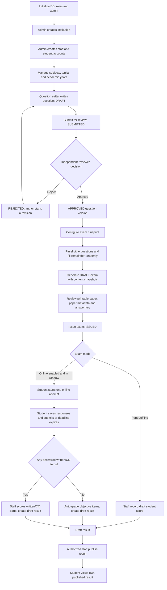
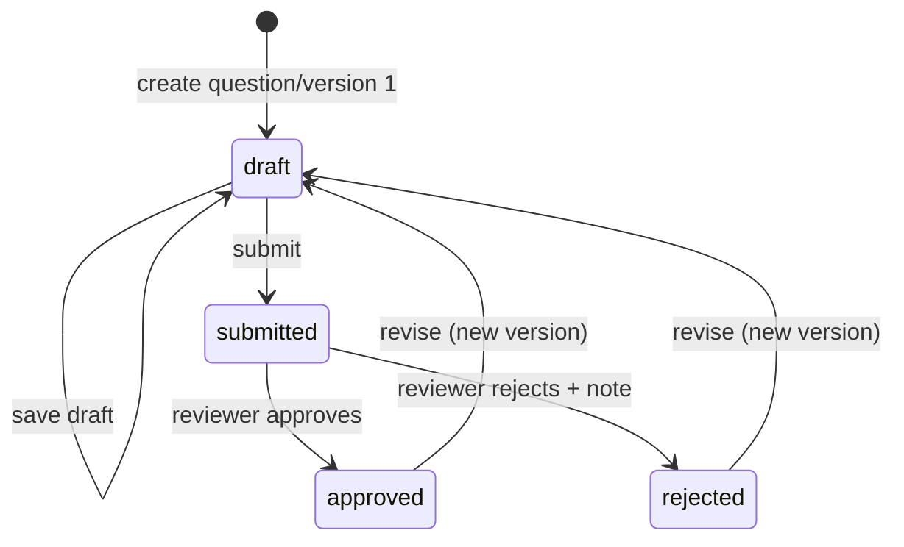
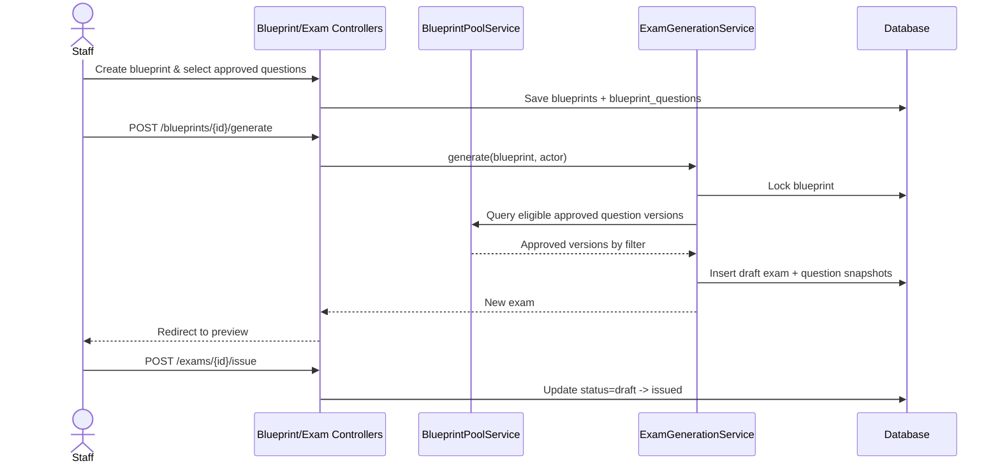
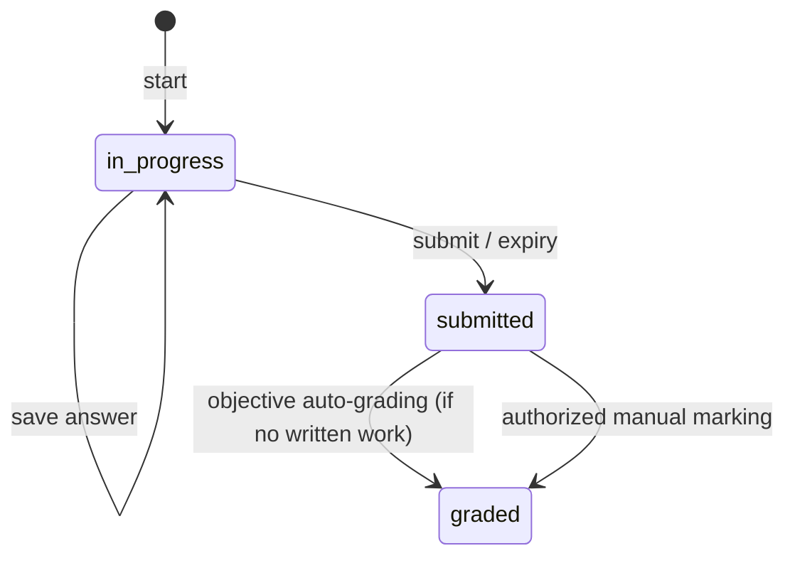
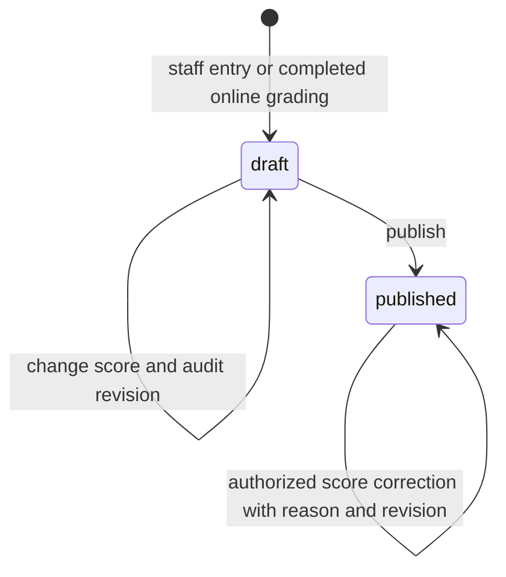

# EQBEMS — End-to-end Workflow, States and Data Map

Derived from `routes/web.php`, `app/Http/Controllers/`, `app/Services/`, and eight migrations in the reviewed source. Paths and methods should be rechecked after future code changes.

## A. The complete process (business view)

## B. Question lifecycle

**Objects:** `Question` is the stable identity and classification; `QuestionVersion` is the mutable/reviewed content. Editable author draft → submission → independent review. Authors cannot approve or reject their own question version (the controller checks creator and author IDs). Rejection requires a reason. Reviewed versions cannot be edited directly; a new draft version is created. For creative format, the revision must preserve `format`, `stimulus`, and four-part content.

**Files:** `QuestionController.php`, `QuestionReviewController.php`, `QuestionService.php`, `Question.php`, `QuestionVersion.php`, `questions/form.blade.php`, `questions/review-queue.blade.php`.

**Rules:** MCQ must have options A–D and one A–D answer. True/False answers are normalized. Creative/CQ must be `type=short`, require a stimulus and parts `ক`, `খ`, `গ`, `ঘ`, currently fixed at **1, 2, 3, 4 marks (10 total)**.

## C. Blueprint and paper generation

1. Staff with `blueprint.manage` define subject, title, count, duration and optional type/difficulty/format.
2. `BlueprintPoolService` returns the most recent **approved version** of each matching question.
3. Staff may explicitly attach eligible questions using `BlueprintQuestionController`.
4. `ExamGenerationService` locks blueprint and verifies enough approved questions exist.
5. All pinned eligible questions are included; the remainder is randomly sampled without duplicating selected question IDs.
6. `Exam` is created as `draft`; `ExamQuestion` stores content and answer **snapshots**.
7. Staff inspect `exams/show` and printable `exams/print`; authorized staff may inspect `exams/answers`.
8. An exam with questions is **issued** by `ExamController@issue` and cannot be issued twice.
9. For online delivery, after issuing, use `/exams/{exam}/settings` to enable `online_enabled` and optionally schedule opening/closing times. The code rejects online enablement of a draft or empty paper.

**Safety:** Do not silently substitute an ineligible pinned question. Modifications to a question after generation must not change an existing exam snapshot. Answer keys are staff-only.

## D. Online exam attempt and grading

**Entry requirements:** Account has role `Student`, student has an institution, exam belongs to that institution, `status=issued`, `online_enabled=true`, and current time is inside allowed schedule for **start**. The system supports **one attempt per student and exam**.

1. Student browses `/online-exams`.
2. Student POSTs `/online-exams/{exam}/start`. `OnlineExamAttempt::firstOrCreate` ensures the attempt is not duplicated.
3. Student opens `/online-exams/{exam}/take` and saves response entries. Server validates that IDs belong to this exam and answer types are valid.
4. Effective deadline is the earlier of `(started_at + duration_minutes)` or `online_end_at` when specified.
5. Student submits or the controller finalizes when time has expired.
6. MCQ/True–False responses are graded server-side against **answer_snapshot**.
7. Non-empty written/CQ responses remain pending for manual assessment. Empty written answers receive zero. If no written response needs marking, grading finishes automatically.
8. Authorized staff open `/online-attempts`, assess short/CQ responses (CQ part-by-part) and submit marks. This finalizes attempt and creates a draft `Result`.
9. Staff with `result.publish` publish the draft result. Students see **only their own published** results.

**Files:** `OnlineExamController.php`, `online/index.blade.php`, `online/take.blade.php`, `online/attempts.blade.php`, `online/grade.blade.php`, models `OnlineExamAttempt` and `OnlineExamAnswer`.

**Important technical observation:** `take()` checks time on page load and auto-finishes expired work. `record()` checks time on save/submit. The reviewed code is request-driven, not evidence of a background queue automatically finalizing idle browser sessions. If timed automatic closure without a request is a requirement, design an explicit scheduled job and write tests.

## E. Result lifecycle

- `ResultController@store` handles staff-entered scores for issued exams; requires matching student institution and `Student` role.
- `GradeService::grade` calculates letter grades based on percentage: A >=80%, B >=70%, C >=60%, D >=50%, else F. It compares integer hundredths of marks, not floating point.
- `ResultController@update` adjusts scores; if score changes it creates a `ResultRevision` audit row. When the result is published, a reason is required.
- `ResultController@publish` changes `draft` to `published` once and adds publisher metadata.
- `ResultController@index` scopes staff views by institution; students only see `published` rows for their own user ID.

**Caution:** The current code allows authorized editing of published marks with recorded reasons; evaluate notification and approval requirements before production use.

## F. Institutions and staff ownership

`Super Admin` creates institutions and users. Other roles receive institution-scoped permissions; a role's permission name alone does not confer cross-institution access. Institution deletion is soft-delete and may be blocked by linked academic records. User deletion/moves respect existing results and online attempts.

## G. Where the data lives

| Business object | Table/model | Created or updated by | Read by |
|---|---|---|---|
| Institution | `institutions` / `Institution` | InstitutionController + InstitutionService | dashboard, academics, users |
| Accounts/roles | `users`, Spatie role tables / `User` | AdminUserSeeder, UserController | auth, access scope, all domains |
| Academic catalog | `subjects`, `topics`, `academic_years` | Subject/Topic/AcademicYear controllers | question forms, blueprints |
| Question drafts and approvals | `questions`, `question_versions` | QuestionController | review queue, blueprint pool |
| Blueprint plans | `blueprints`, `blueprint_questions` | Blueprint controllers | exam generation |
| Generated exam | `exams`, `exam_questions` | ExamGenerationService, ExamController | print, online, results |
| Online submissions | `online_exam_attempts`, `online_exam_answers` | OnlineExamController | grading |
| Grades and audit | `results`, `result_revisions` | OnlineExamController / ResultController | staff and student results |

## H. Domain invariants to preserve in new code

- One tenant must not read or modify another tenant's data.
- Reviewers must not self-approve their own questions.
- Candidate question content is independent from answer keys.
- Generated paper questions are snapshots; new revisions do not rewrite old exams.
- A student gets one attempt and one result for a given exam.
- Scores are bounded by maximum marks, including each creative part.
- Draft results are not visible to students.
- Status transitions should be controlled; use DB transactions and locks for concurrent changes.
