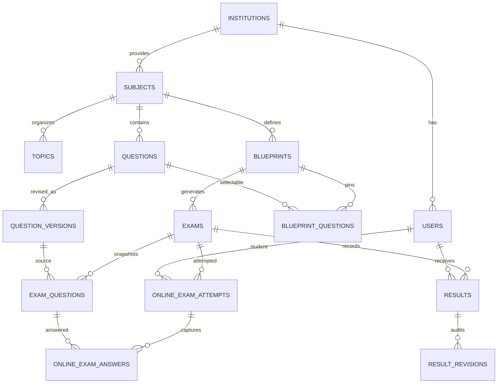

# Schema and migration reference

**Read the migration source as authoritative.** This page is a navigational inventory, not a generated database ERD. The Spatie RBAC migration uses configured table names.

**Migration files:** 8.

- `0001_01_01_000000_create_users_table.php`
- `0001_01_01_000001_create_cache_table.php`
- `0001_01_01_000002_create_jobs_table.php`
- `2026_07_04_190837_create_permission_tables.php`
- `2026_07_05_142437_create_institutions_table.php`
- `2026_10_20_000001_create_academic_and_exam_tables.php`
- `2026_10_20_000002_create_online_exam_and_paper_format_tables.php`
- `2026_10_20_000003_create_blueprint_questions_table.php`

## Domain tables

| Table | Responsibility | Source of truth |
|---|---|---|
| `users` | Account and optional institution membership | initial user migration + 2026 academic migration |
| `institutions` | Tenant/institution directory, soft deletion | institution migration |
| `subjects`, `topics`, `academic_years` | Academic catalog | academic migration |
| `questions`, `question_versions` | Question identity and versioned review states | academic migration + online/CQ amendment |
| `blueprints`, `blueprint_questions` | Exam selection criteria + pinned questions | academic migration + blueprint questions migration |
| `exams`, `exam_questions` | Issued/draft papers and immutable question/answer snapshots | academic migration + online/CQ amendment |
| `online_exam_attempts`, `online_exam_answers` | Student attempt state and answers | online/CQ amendment |
| `results`, `result_revisions` | Scores, publication and changes | academic migration |
| `roles`, `permissions`, `model_has_roles`, `model_has_permissions`, `role_has_permissions` | Spatie RBAC | permission tables migration |
| `sessions`, `cache`, `cache_locks`, `jobs`, `job_batches`, `failed_jobs`, `password_reset_tokens` | Laravel infrastructure | initial framework migrations |

## Key relationships

## Integrity rules in the actual migrations

- Each question/version pair is unique by `(question_id, version_number)`.
- Each student may have one attempt per exam via `(exam_id, student_id)` on `online_exam_attempts`.
- Each student may have one result per exam via `(exam_id, student_id)` on `results`.
- Each exam-question position and version link is unique within an exam.
- Institutions use soft deletes; academic history uses restrictive foreign keys in several places.
- Snapshot fields on `exam_questions` separate an issued paper from future edits to questions.
- `creative_parts` is JSON with Bangla part keys (`ক`, `খ`, `গ`, `ঘ`) and fixed marks 1+2+3+4 in the current validator.

## Migration safety

On a working database, use `php artisan migrate` and `php artisan migrate:status`. **Never** use `migrate:fresh` or `db:wipe` on real data. For schema changes, add a new migration; do not change already deployed migrations retroactively.
